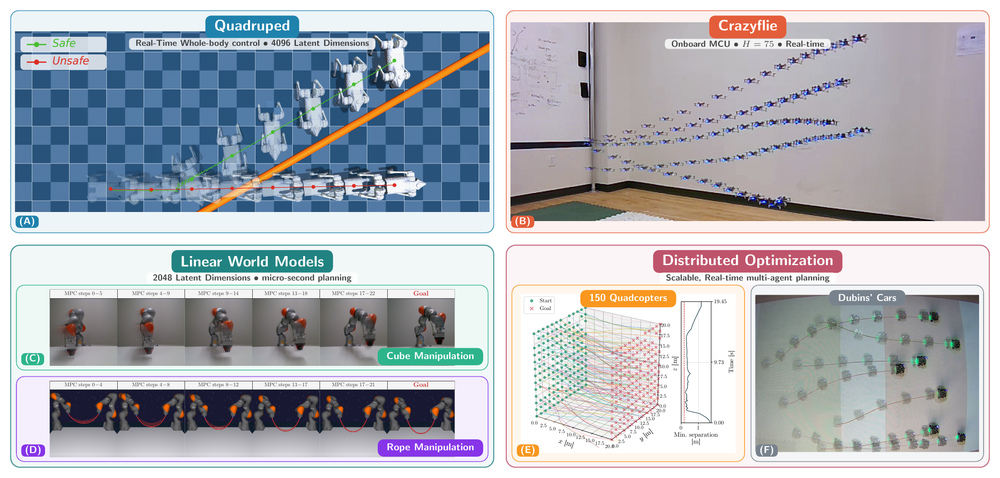

# 

<p align="center">
  <strong><a href="https://www.deveshnath.com/projects/micrompc/" target="_blank" rel="noopener noreferrer">Project Website</a>&nbsp;&nbsp; · &nbsp;&nbsp;<a href="https://arxiv.org/abs/2611.34597v1" target="_blank" rel="noopener noreferrer">Paper</a>&nbsp;&nbsp; · &nbsp;&nbsp;<a href="https://youtu.be/KMsVFYA1S3A" target="_blank" rel="noopener noreferrer">Video</a></strong>
</p>

**Constrained nonlinear and world model control in microseconds.**

μMPC compiles learned Koopman dynamics into compact, action-only quadratic
programs. Precomputed operators make online primal-dual iterations simple:
matrix-vector products and projections.

Pretrained models and examples for quadrotor control and visual rope manipulation.

[](docs/assets/micrompc-overview.pdf)

## Install

From this directory, with Python 3.11 on Linux. Rope simulation requires an NVIDIA GPU.

```bash
uv venv --python 3.11
source .venv/bin/activate
uv pip install --no-deps -r requirements.txt

mkdir -p third_party
git clone https://github.com/galilai-group/stable-pretraining.git third_party/stable-pretraining
git -C third_party/stable-pretraining checkout 9aa93f8b6153eebb73f57d4853ccf8a13d848310
uv pip install --no-deps -e third_party/stable-pretraining
uv pip install --no-deps -e .
```

Prefer pip? Replace `uv pip` with `python -m pip` after activating the environment.

## Run

Quadrotor: nominal control, obstacle avoidance, and multi-robot planning.

```bash
python -m micrompc.examples.quad3d.plan.plan_nominal
python -m micrompc.examples.quad3d.plan.plan_obs
python -m micrompc.examples.quad3d.plan.plan_ibr
```

Rope: generate initial states and goal images, then plan.

```bash
python -m micrompc.examples.rope.data.generate_data \
  --outdir rope/data/test --num-trajectories 8 --batch-size 8
python -m micrompc.examples.rope.plan.plan_nominal
```

## Train

Quadrotor:

```bash
python -m micrompc.examples.quad3d.data.generate_data \
  --num-trajectories 500 --workers 10
python -m micrompc.examples.quad3d.train.train_inverse_qp
```

Rope:

```bash
python -m micrompc.examples.rope.data.generate_data --outdir rope/data/train
python -m micrompc.examples.rope.train.train
```

## Code

```text
solver/     Primal-dual MPC and differentiable inverse QP
trainer/    Koopman losses and DAgger schedule
examples/   Quadrotor and visual rope control
```

## Models

- Quadrotor: `examples/quad3d/models/KO_quad3d.pt`
- Rope: `examples/rope/models/KO_rope/last.ckpt`

## License

Code and bundled model checkpoints are licensed under the [MIT License](LICENSE).
Third-party robot assets retain their [license](examples/rope/shared/kuka_iiwa_14/LICENSE).
